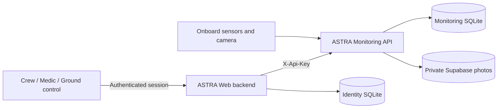

# ASTRA Web

**Human health, beyond Earth.** ASTRA is a crew-focused health-monitoring prototype built for the **2026 NASA International Space Apps Challenge**, [Create Health Monitoring Software for Astronauts on Space Missions](https://www.spaceappschallenge.org/2026/challenges/health-monitoring-software/?tab=details).

The challenge asks teams to help astronauts collect health indicators, evaluate changes, and act on their health during space missions. ASTRA connects hardware readings to a personal dashboard, an onboard medic's crew-health view, and a ground-control overview.

This repository contains the web application. The [ASTRA Monitoring API](https://github.com/ASTRA-NASA-App-Challenge/ASTRA-Monitoring) handles device communication, measurement storage, and Supabase photos. The two applications run separately.

## What the application does

- Displays live **heart rate, cabin temperature, and cabin relative humidity**, with measurement timestamps in English and UTC.
- Shows **7-day and 30-day history** as an interactive line chart. Clicking or keyboard-activating a point opens its details. Period changes load in the background without navigating away.
- Provides averages, minimums, maximums, and an expandable measurement table that follows the selected metric. Pulse rows also show sensor signal quality. Period switching updates statistics only; Refresh reloads the other health and photo panels.
- Displays the latest available photo within the selected page's loaded history, retrieved through authorized server endpoints.
- Tracks the next check-in **six hours after the latest pulse measurement**, with a countdown and overdue state.
- Uses severity colours on measurements, history points, table statuses, member cards, and a simple 2D body illustration.
- Provides contextual guidance, sensor-quality warnings, missing-reading states, and stale-data notices.
- Supports responsive desktop/mobile layouts, animated filters and sorting, and animated chart popups and tables.

Cabin temperature is **not body temperature**. The application does not infer blood pressure, blood oxygen, stress, sleep, or other unmeasured indicators from the available sensors.

## Roles and access

| Capability | Crew | Medic | Ground control |
| --- | --- | --- | --- |
| Personal dashboard and own PIN | Yes | Yes; default landing page | No onboard measurement profile |
| View other onboard members' measurements, history, and photos | No | Yes | Yes |
| Crew-health overview, severity, and attention filtering | No | Yes; excludes the signed-in medic | Yes |
| View other members' PINs | No | No | Yes |
| Create, edit, or delete onboard accounts | No | No | Yes |

Medics switch between **My Health** and **Crew Health**. Ground control uses **Crew Overview**, where cards link to each member's health view. Both overviews support search, role filters, attention-first sorting, and an attention-only filter.

There is no public registration or account-management page. Ground control creates crew and medic accounts using first name, optional middle name, last name, username, and role. A unique six-digit PIN is generated automatically. Editing names or roles preserves the PIN; access changes invalidate existing sessions on their next authenticated request.

All users log in with a **username**. Crew and medics use their PIN as their password; ground control uses a conventional password. Email is not part of the account model or login flow.

## Technology and structure

- .NET 10 / ASP.NET Core MVC and Razor Pages
- ASP.NET Core Identity for accounts, roles, and cookie authentication
- Entity Framework Core and a persistent SQLite database
- Bootstrap 5, plain JavaScript, CSS, and SVG; no frontend package build is required
- xUnit tests

```text
ASTRA-Web/                     # Repository root
├── README.md
├── LICENSE
└── ASTRA-Web/                 # Solution directory
    ├── ASTRA-Web.slnx
    ├── Common/                # Shared roles, models, and severity rules
    ├── Entities/              # Identity entities
    ├── Data/                  # EF Core context, migrations, database initialization
    ├── Services/              # Account validation, PIN protection, provisioning, roster services
    ├── Web/                   # MVC/Razor UI, monitoring client, synchronization workers
    └── Tests/                 # Identity, authorization, persistence, and integration-client tests
```

## Run locally

The commands below assume the **repository root**, containing this README. If your terminal is already in the solution directory, omit the initial `ASTRA-Web/` from project paths.

### 1. Prerequisites

Install the [.NET 10 SDK](https://dotnet.microsoft.com/download/dotnet/10.0). Rider, Visual Studio, and the .NET CLI are supported. A modern browser is recommended for the animations and interactive charts.

For a complete demo, also obtain the monitoring repository and configure its SQLite database, API key, devices, and Supabase storage according to its [README](https://github.com/ASTRA-NASA-App-Challenge/ASTRA-Monitoring#readme). A common local layout is:

```text
ASTRA-NASA-App-Challenge/
├── ASTRA-Web/
└── ASTRA-Monitoring/
```

### 2. Configure the web host

On a fresh checkout, copy the example file; preserve an existing `.env` rather than overwriting it:

```powershell
Copy-Item ASTRA-Web/Web/.env.example ASTRA-Web/Web/.env
```

Set these values in `ASTRA-Web/Web/.env`:

```dotenv
ConnectionStrings__DefaultConnection="Data Source=astra.db"
Identity__PinLookupKey=REPLACE_WITH_A_STABLE_RANDOM_SECRET_OF_AT_LEAST_32_BYTES
MonitoringApi__BaseUrl=http://localhost:5191/
MonitoringApi__WebApiKey=REPLACE_WITH_THE_SAME_SECRET_CONFIGURED_ON_MONITORING
```

| Setting | Purpose |
| --- | --- |
| `ConnectionStrings__DefaultConnection` | Web account database; relative paths resolve against the `Web` project's content root |
| `Identity__PinLookupKey` | Stable secret used for keyed PIN uniqueness checks; at least 32 UTF-8 bytes |
| `MonitoringApi__BaseUrl` | Monitoring API address, defaulting to `http://localhost:5191/` |
| `MonitoringApi__WebApiKey` | Shared web-to-server secret; 32–512 characters; sent as `X-Api-Key` only by the backend |
| `Demo__Enabled` | Enables demo account seeding and one-click demo access; enabled in Development configuration, otherwise false unless explicitly configured |
| `Demo__Prepare` | Optional one-time legacy-account replacement; leave unset for normal operation |

Configuration precedence is **appsettings defaults → `.env` → user secrets → environment variables → command-line arguments**. The `.env` file belongs in the `Web` project, not beside the solution. Do not commit real secrets.

The web host does **not** need the Supabase service-role key. Supabase settings appearing in the example file are not used by the current web monitoring client; photo storage credentials belong on the monitoring server.

For an existing installation, retain its PIN lookup secret and ASP.NET Core Data Protection keys. Replacing them can prevent existing PIN lookup, decryption, and synchronization from working correctly.

### 3. Start both applications

Start Monitoring in another terminal, using the sibling layout above:

```powershell
dotnet run --project ../ASTRA-Monitoring
```

Verify its API at `http://localhost:5191/api/v1/healthz`, then restore and run Web:

```powershell
dotnet restore ASTRA-Web/ASTRA-Web.slnx
dotnet run --project ASTRA-Web/Web --launch-profile https
```

Open **https://localhost:7161**. If necessary, trust the local development certificate:

```powershell
dotnet dev-certs https --trust
```

The `http` launch profile uses **http://localhost:5233**. Both launch profiles select the Development environment. Without a launch profile, set `ASPNETCORE_ENVIRONMENT` explicitly if you want development/demo behaviour.

Web can start while Monitoring is unavailable, provided the required configuration is present. Accounts and login remain available; health views report unavailable data and synchronization retries later.

## Demo accounts and reviewer walkthrough

Development mode creates ground control if absent. With demo mode enabled, it also seeds two medics and four crew members. Existing accounts and credentials are not reset. Reserved or already-assigned PINs are not reused.

| Username | Name | Role | Initial demo credential |
| --- | --- | --- | --- |
| `ASTRA Ground Control` | Ground control | GroundControl | Password: `Astra123!2026` |
| `Medic` | Maya Chen | Medic | PIN: `410201` |
| `dr.reed` | Samuel Reed | Medic | PIN: `410202` |
| `Crew` | Alex Morgan | Crew | PIN: `520301` |
| `jordan.lee` | Jordan Lee | Crew | PIN: `520302` |
| `sofia.patel` | Sofia Patel | Crew | PIN: `520303` |
| `noah.rivera` | Noah Rivera | Crew | PIN: `520304` |

The ground-control password above applies to a newly seeded development account. An existing account keeps its existing password.

When `Demo:Enabled=true`, the login page offers **Ground Control**, **Medic**, and **Crew** buttons. They sign into three whitelisted demo profiles without entering credentials. This is intentional public demo access, not the normal authentication flow. Disable demo mode for a non-demo deployment.

Suggested walkthrough:

1. Choose **Crew**: inspect the personal readings, PIN, check-in countdown, latest photo, and body colour.
2. Switch chart metrics and Week/Month; open a point popup and expand the matching history table.
3. Open guidance for an unusual reading.
4. Log out and choose **Medic**: inspect My Health, then Crew Health. The signed-in medic's own card is excluded; account controls and other members' PINs are unavailable.
5. Choose **Ground Control**: use attention filtering and sorting, open a member's health page, and inspect the account-management modal. Account deletion removes real demo data, so avoid it during a presentation unless that is intended.

### Measurement and photo seeding

Web seeds **accounts**, not measurement history or photos. The Monitoring repository has a separate `Tools/DemoSeeder` tool for the six presentation PINs. It creates synthetic histories and uploads fictional portraits to private Supabase storage.

From the **Monitoring repository root**, with its configuration, registered PINs, and portrait assets available:

```powershell
dotnet run --project Tools/DemoSeeder --artifacts-path ./bin/demo-build -- inspect
dotnet run --project Tools/DemoSeeder --artifacts-path ./bin/demo-build -- prepare
dotnet run --project Tools/DemoSeeder --artifacts-path ./bin/demo-build -- verify
```

Before presenting, refresh the demo readings so they do not age into overdue states:

```powershell
dotnet run --project Tools/DemoSeeder --artifacts-path ./bin/demo-build -- refresh
```

The tool retains its state and report beneath Monitoring's `.demo/presentation-v1/`; preserve that state and the original portrait assets for repeatable runs. Consult the Monitoring repository for the tool's requirements. These are server-side commands, not Web account-reset commands.

The six scenarios cover green, lime, yellow, orange, red, and grey/overdue states. They are synthetic demonstration data, not actual astronaut medical records.

### Optional one-time replacement of legacy local accounts

This is **not required on a fresh checkout**. To replace the old `salex` and `ASTRA Test Astronaut` accounts with the presentation roster:

```powershell
dotnet run --project ASTRA-Web/Web --launch-profile http -- --Demo:Prepare=true
```

This explicitly deletes those two named accounts through the normal deletion service, queues their monitoring cleanup, seeds missing demo accounts, attempts PIN registration, and then exits. Ground control is preserved. Back up the database and its encryption keys before using this maintenance action. Normal startup does not perform this replacement.

## Measurement flow and photos



1. Ground control creates an onboard account in Web; its six-digit PIN is registered with Monitoring. Failed registrations retry approximately every 30 seconds.
2. Hardware sends pulse, cabin temperature/humidity, and camera captures to Monitoring. Monitoring identifies crew by PIN; it does not need web usernames or account passwords.
3. Web validates the viewer's role and member access before requesting measurements or photos. PINs and the API key are not placed in browser-facing monitoring URLs.
4. History uses fixed UTC bounds and follows pagination cursors. The web views support 7-day and 30-day windows.
5. Photos are uploaded by Monitoring to `{pin}/{measurementId}.jpg` in the configured Supabase bucket. The bucket can stay private; the server downloads with its service credentials, and Web streams the authorized JPEG to the browser.

The monitoring photo endpoint accepts supported 160×120 or 320×240 captures, limits uploads to 5 MiB, and requires upload within five minutes of measurement creation. A database row or a Supabase URL alone does not constitute a successfully uploaded photo.

The UI displays the latest uploaded photo available in its loaded history. Missing photos or download failures produce an unavailable state rather than a fabricated image.

Relevant server routes are:

| Method | Route | Web use |
| --- | --- | --- |
| `POST` | `/api/v1/crew` | Register a PIN |
| `GET` | `/api/v1/crew/{pin}/measurements` | Pulse history |
| `GET` | `/api/v1/crew/{pin}/environment-readings` | Cabin history |
| `GET` | `/api/v1/crew/{pin}/measurements/{id}/photo` | Authorized JPEG retrieval |
| `DELETE` | `/api/v1/crew/{pin}` | Retire a deleted member and remove monitoring data |

History responses use snake_case JSON with `items` and `next_cursor`; the server accepts at most 100 records per page and a maximum 31-day query window. Device authentication and upload details are documented in the Monitoring repository.

## Check-ins and colour interpretation

A check-in is due six hours after the latest pulse measurement. The countdown does **not** initiate hardware capture or run an automatic medical diagnosis. **Start check-in** opens guidance; the member takes a reading on the hardware and refreshes the dashboard. Active dashboard pages also attempt a refresh about once per minute, avoiding an open modal, active point popup, or in-progress period change.

Severity rules are centralized in [HealthSeverity.cs](ASTRA-Web/Common/Models/HealthSeverity.cs):

| Colour | Status | Example good-quality pulse |
| --- | --- | --- |
| Green | In range | 60–100 bpm |
| Lime | Slight deviation | 50–59 or 101–110 bpm |
| Yellow | Caution | 40–49 or 111–130 bpm |
| Orange | High alert | 35–39 or 131–160 bpm |
| Red | Urgent review | Below 35 or above 160 bpm |
| Grey | Incomplete/unreliable | Missing pulse, zero BPM, or quality other than `good` |

Cabin temperature uses a broad green band of 18–27°C, with progressively higher severity beyond the 16–29, 14–32, and 10–35°C bands. Humidity uses 25–75%, then 20–80%, 15–85%, and 10–90%. Apply the narrowest matching band first. Invalid humidity values outside 0–100% are unknown.

Each metric is assessed independently. The body and member card use the **highest** detected severity rather than an average, so a normal measurement cannot dilute a severe one. An otherwise in-range summary becomes incomplete when required data is missing or stale. Historical alerts may remain coloured; always inspect their timestamps. The body is a status illustration, not an anatomical diagnosis.

**These extra severity bands are prototype screening rules, not validated medical triage.** The broad cabin bands simplify NASA's coupled temperature/humidity envelope and do not establish mission compliance. Pulse depends on activity, fitness, signal quality, and personal baseline. The app has no diagnostic AI, validated treatment engine, symptom assessment, or certification for operational medical use. Photos are visual records, not diagnostic inputs.

References used for context and in-app guidance:

- [NASA Space Apps challenge](https://www.spaceappschallenge.org/2026/challenges/health-monitoring-software/?tab=details) and [resources tab](https://www.spaceappschallenge.org/2026/challenges/health-monitoring-software/?tab=resources).
- [NASA-STD-3001: natural and induced environments](https://www.nasa.gov/reference/6-0-natural-and-induced-environments-vol-2/).
- [Canadian Space Agency: Bio-Monitor](https://www.asc-csa.gc.ca/eng/sciences/bio-monitor.asp).
- [American Heart Association: heart rate and pulse](https://www.heart.org/en/health-topics/high-blood-pressure/the-facts-about-high-blood-pressure/all-about-heart-rate-pulse).

## Persistence, credentials, and deletion

Web's default SQLite file is `ASTRA-Web/Web/astra.db`. It persists across restarts and is ignored by Git. EF Core applies pending migrations; startup does not delete and recreate the database. Identity, Monitoring SQLite, and Supabase storage are separate stores.

Passwords/PINs are stored as salted Identity hashes. PIN uniqueness uses HMAC with the stable lookup secret. A separate Data Protection-encrypted PIN copy allows authorized display and server synchronization. Back up the database **and the Data Protection key ring**, and keep the application's `ASTRA` Data Protection name stable.

Crew/medic PINs contain exactly six ASCII digits and remain unique, including across retired PIN reservations. Ground-control passwords require at least 12 characters, uppercase, lowercase, a digit, and a non-alphanumeric character. Normal password login locks accounts for 15 minutes after five failed attempts.

Deleting an onboard account atomically removes the web account and records pending monitoring cleanup. A worker retries delivery. Monitoring retires the PIN, revokes device access, removes measurements and environment data, and cleans up its photo folder. PIN reservations remain to prevent a later person inheriting the deleted person's history. Deleted or reserved PINs must not be reused.

## Build and test

From the Web repository root:

```powershell
dotnet build ASTRA-Web/ASTRA-Web.slnx --configuration Release
dotnet test ASTRA-Web/Tests/Tests.csproj --configuration Release
```

Coverage includes role restrictions, PIN validation and protection, account creation/editing/deletion, medic confidentiality, persistent migrations, durable monitoring cleanup, demo seeding/login gates, API serialization and pagination, and severity calculations. Tests use isolated databases or mocked HTTP services; browser interactions have also been checked manually/headlessly during development. The server has its own separate test suite.

If Rider reports `MSB3026`, `MSB3027`, or `MSB3021` and says a DLL is locked by `Web`, stop the running Web/debug session before rebuilding or testing that output configuration. This is a build-time file lock, not a failed test assertion.

## Deployment and troubleshooting

For a non-demo deployment, set `Demo__Enabled=false`, use the Production environment, configure HTTPS, protect the API connection, and persist both databases and the Data Protection keys. Development's seeded credentials are not production credentials.

Production ground-control provisioning can use configuration (store the real password in a secret provider):

```dotenv
Identity__Accounts__0__UserName=Mission Ground Control
Identity__Accounts__0__Role=GroundControl
Identity__Accounts__0__Password=REPLACE_WITH_A_STRONG_PRIVATE_PASSWORD
```

Only ground-control accounts can be provisioned through this configuration; onboard accounts are created through the admin UI. Provisioning preserves an existing matching account's password and rejects a role mismatch rather than silently changing its privileges.

| Symptom | Check |
| --- | --- |
| Startup asks for `MonitoringApi:WebApiKey` | Supply a 32–512 character value matching Monitoring; confirm `.env` is in the Web project |
| Login works but readings are unavailable | Monitoring URL, liveness endpoint, shared key, PIN registration, and network access |
| New member has no readings | Registration retries may still be pending; registration does not create sensor readings |
| Photo is absent | Supabase configuration on Monitoring, successful upload status, supported image dimensions, upload window, and authenticated retrieval |
| An existing PIN cannot be decrypted | Restore the original Data Protection keys; do not reset the database as a workaround |
| Old PIN fails uniqueness checks | It may be reserved after deletion; use a new PIN |
| Demo profiles appear without history | Run the separate Monitoring demo preparation, then verify its photos and records |
| Most demo readings become stale | Run the Monitoring demo `refresh` command; the web app does not generate new measurements |
| Quick-login buttons are absent | Demo mode is disabled; normal credential login still works |

The [body illustration](ASTRA-Web/Web/wwwroot/images/crew-body.png) and presentation portraits are synthetic assets; no real medical condition is inferred from the illustration.

## License

The Web repository is licensed under the [MIT License](LICENSE). Related repositories and external resources retain their own licenses.
